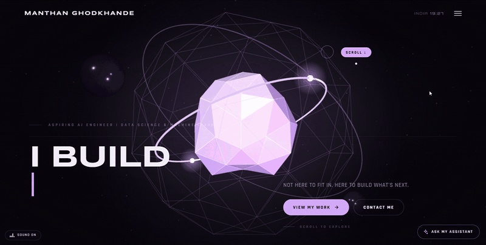
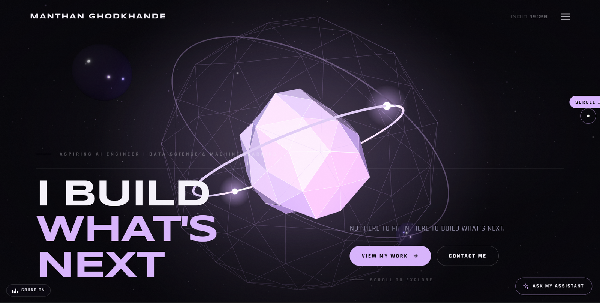
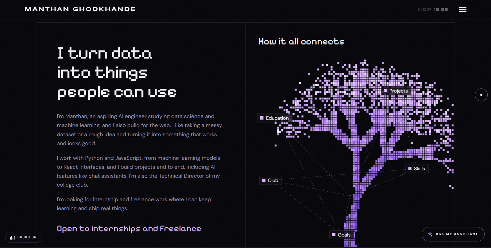
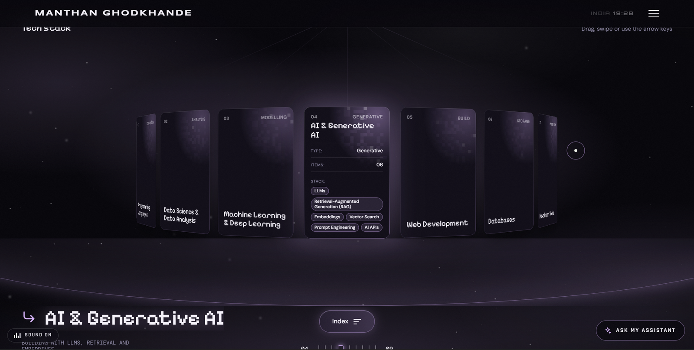
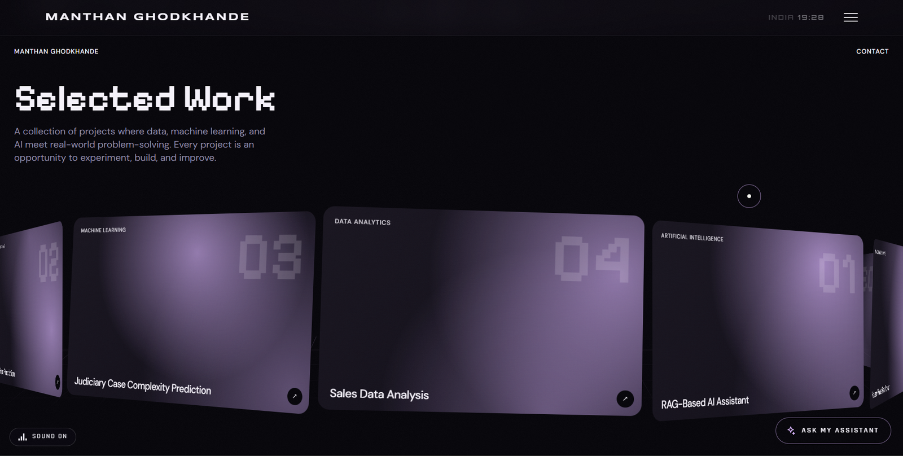
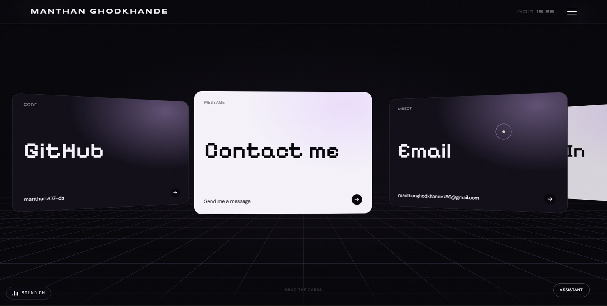
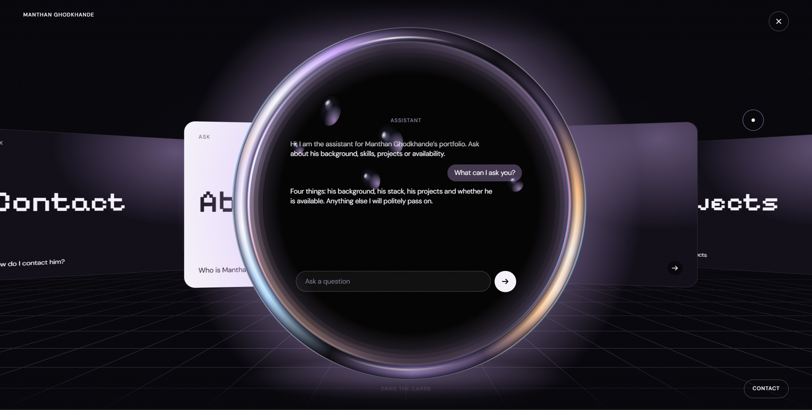

<div align="center">

# Manthan Ghodkhande | Portfolio

**Not here to fit in. Here to build what's next.**

An immersive, single-page developer portfolio with a real-time 3D hero, scroll-driven storytelling, an interactive project carousel, adaptive sound, and an AI assistant that answers questions about me.

[](https://react.dev)
[](https://vitejs.dev)
[](https://threejs.org)
[](https://gsap.com)
[](https://ai.google.dev)
[](https://vercel.com)

[**Live Demo**](https://manthan-portfolio-phi.vercel.app/) · [**Report a Bug**](https://github.com/manthan707-ds/MANTHAN.portfolio/issues) · [**Connect on LinkedIn**](https://www.linkedin.com/in/manthan-ghodkhande/)

</div>

---

## Preview

<div align="center">



</div>

<table>
  <tr>
    <td align="center" width="50%"><b>Hero (WebGL)</b><br></td>
    <td align="center" width="50%"><b>About</b><br></td>
  </tr>
  <tr>
    <td align="center" width="50%"><b>Tech Stack</b><br></td>
    <td align="center" width="50%"><b>Work</b><br></td>
  </tr>
  <tr>
    <td align="center" width="50%"><b>Contact</b><br></td>
    <td align="center" width="50%"><b>AI Assistant</b><br></td>
  </tr>
</table>

---

## About this project

I'm an aspiring AI engineer working in data science and machine learning, and the Technical Director of my college club. This portfolio is where I show how I build, not just what I list on a CV.

Instead of a template, almost every effect is **hand-written**: the 3D scene, the canvas drawings, the carousel physics, the sound engine, and the chatbot backend. The whole site runs on **four runtime dependencies**.

## Features

- **Real-time 3D hero**: a WebGL scene (faceted crystal, orbit rings, wire shell, floating dust) built with Three.js. It reads its colours from CSS tokens, uses a seeded random generator so it looks the same on every load, and falls back gracefully when WebGL isn't available.
- **Cinematic preloader and custom cursor**, plus magnetic buttons and a typed headline.
- **Scroll-driven About section**: GSAP + ScrollTrigger word reveals and a pixel-art "how it all connects" tree drawn on a 2D canvas.
- **Interactive Tech Stack**: a GSAP-powered carousel of tool groups (languages, data science, ML/DL, generative AI, web, databases, dev tools, deployment).
- **Work showcase**: a custom drag / wheel / touch carousel (Pointer Events + `requestAnimationFrame`) with a detail panel per project. Adding a project means adding one object to a data file.
- **Contact + AI assistant**: a canvas-drawn perspective floor and glass ring, a contact form, and a chat assistant powered by Google Gemini.
- **Adaptive sound design**: a small audio engine with a background loop, a project-section loop that crossfades in, and a transition sound. It starts on first interaction, and visitors can mute it (the choice is remembered).
- **Accessibility and performance**: respects `prefers-reduced-motion`, detects fine vs. touch pointers, pauses off-screen work with `IntersectionObserver`, adds a skip link, and handles phone safe-area insets.
- **Data-driven content**: text, projects, links and assistant knowledge live in `src/data/` and `api/`, so most edits never touch component code.

## Tech stack

| Layer | Tools |
|---|---|
| **Framework** | React 18 (hooks), Vite 5 |
| **3D / Graphics** | Three.js (WebGL), HTML Canvas 2D |
| **Animation** | GSAP 3, ScrollTrigger, CSS transforms |
| **Styling** | Plain CSS with a design-token file (no CSS framework) |
| **Audio** | Browser `Audio` API (custom engine, no library) |
| **Backend** | Serverless function (Node.js, Vercel-style `/api`) |
| **AI** | Google Gemini API (`gemini-2.5-flash`) with a system-prompt knowledge base |
| **Fonts** | Syncopate, Rajdhani, Orbitron, Pixelify Sans, DM Sans, DM Mono (Google Fonts) |
| **Deployment** | Vercel |

## How the AI assistant works

```
Browser (chat UI)  ──POST /api/chat──▶  Serverless function  ──▶  Gemini API
                                           │
                                           ├─ cleans chat history
                                           ├─ adds the knowledge base (api/_knowledge.js)
                                           ├─ rate-limits (20 requests / minute / visitor)
                                           ├─ trims cut-off answers to the last full sentence
                                           └─ optionally returns an "Open contact" action
```

- The **API key never reaches the browser**. It lives in an environment variable on the server.
- `api/_knowledge.js` holds the assistant's personality, response rules, and facts about me and my projects. Edit it to "retrain" the assistant. The leading underscore keeps Vercel from exposing it as a public route.
- The assistant is **grounded through a system prompt**, not a vector database. A full RAG version is on my roadmap.

## Project structure

```
portfolio/
├── api/
│   ├── chat.js            # POST /api/chat → Gemini (rate limit, cleanup)
│   ├── _knowledge.js      # Everything the assistant knows about me
│   └── _lib.js            # Helpers for chat.js
├── docs/                  # README screenshots and demo GIF
├── public/
│   ├── audio/             # main.mp3, projects.mp3, transition.mp3
│   └── work/              # Project screenshots
├── src/
│   ├── components/        # Preloader, Cursor, Navbar, HeroScene, SoundToggle, AssistantFab, TypedText
│   ├── sections/          # Hero, About, TechStack, Work, Contact
│   ├── hooks/             # useMagnetic
│   ├── lib/               # audio engine, pixel tree, utils
│   ├── data/              # profile, about, projects, contact, assistant (edit content here)
│   ├── styles/            # tokens.css, global.css, preloader.css
│   ├── App.jsx
│   └── main.jsx
├── dev-api.js             # Serves /api during `npm run dev`
├── vite.config.js
├── index.html
└── .env.example
```

## Getting started

### Prerequisites

- [Node.js](https://nodejs.org) **18 or newer** (LTS recommended). Check with `node -v`.
- A free Gemini API key from [Google AI Studio](https://aistudio.google.com/apikey) (optional: the site works without it, only the assistant stays silent).

### Installation

```bash
# 1. Clone the repository
git clone https://github.com/manthan707-ds/MANTHAN.portfolio.git
cd MANTHAN.portfolio

# 2. Install dependencies
npm install

# 3. Add your environment variables
cp .env.example .env        # Windows: copy .env.example .env
# then open .env and set GEMINI_API_KEY=your_key_here

# 4. Start the dev server
npm run dev
```

Open the address Vite prints (usually `http://localhost:5173`).

> If you edit `.env` or `api/_knowledge.js`, stop and restart `npm run dev`.

### Scripts

| Command | What it does |
|---|---|
| `npm run dev` | Start the dev server (also serves `/api`) |
| `npm run build` | Create a production build in `dist/` |
| `npm run preview` | Preview the production build (does **not** run `/api`, use `vercel dev` for that) |

### Environment variables

| Variable | Required | Description |
|---|---|---|
| `GEMINI_API_KEY` | For the assistant | Your Google Gemini API key |
| `GEMINI_MODEL` | No | Override the model (default: `gemini-2.5-flash`) |

## Deployment (Vercel)

1. Push the repo to GitHub.
2. Import it at [vercel.com/new](https://vercel.com/new). Vite is detected automatically.
3. Add `GEMINI_API_KEY` under **Project → Settings → Environment Variables**.
4. Deploy. Vercel serves the `/api` folder as serverless functions.

Live site: [manthan-portfolio-phi.vercel.app](https://manthan-portfolio-phi.vercel.app/)

## Customising

| I want to change… | Edit |
|---|---|
| Colours | `src/styles/tokens.css` (update the matching `rgb` lines too) |
| Name, role, nav, hero buttons | `src/data/profile.js` |
| About text and tree labels | `src/data/about.js` |
| Tech stack tools | `STACK` at the top of `src/sections/TechStack/TechStack.jsx` |
| Projects | `src/data/projects.js` (images go in `public/work/`) |
| Email, links, résumé | `src/data/contact.js` |
| Assistant personality and facts | `api/_knowledge.js` |
| Sound | Replace files in `public/audio/` and adjust volumes in `src/lib/audio.js` |

## Featured projects shown on the site

| Project | Stack | Status |
|---|---|---|
| **RAG-Based AI Assistant** | Python, LLMs, RAG, Embeddings, AI APIs | In progress |
| **House Price Prediction** | Python, Pandas, Scikit-learn, Ridge Regression, Streamlit | Built |
| **Judiciary Case Complexity Prediction** | Python, Pandas, Scikit-learn | Team project |
| **Sales Data Analysis** | Python, Pandas, Matplotlib | Built, improving |

## Roadmap

- [x] Add README screenshots and demo GIF
- [ ] Connect the contact form (`api/contact.js`, then set `ENDPOINTS.contact` in `src/data/contact.js`)
- [ ] Add live-demo links for each project
- [ ] Add favicon, Open Graph image and résumé PDF
- [ ] Upgrade the assistant from prompt-based knowledge to full RAG with embeddings
- [ ] Add a project case-study page for each project

## Troubleshooting

- **Blank black page**: open the browser console (F12) and read the first red error. Make sure you ran `npm install`.
- **Assistant says "Something went wrong"**: the key in `.env` is missing or wrong, or you're offline.
- **Port 5173 is busy**: Vite picks the next free port and prints it.
- **No sound**: browsers block audio until the first click, key press or tap. This is expected.

## Contact

**Manthan Ghodkhande**
- Email: [manthanghodkhande786@gmail.com](mailto:manthanghodkhande786@gmail.com)
- LinkedIn: [manthan-ghodkhande](https://www.linkedin.com/in/manthan-ghodkhande/)
- GitHub: [manthan707-ds](https://github.com/manthan707-ds)

Open to data science and AI internships and freelance work.

## License

This is a personal portfolio. The source is public for learning and reference. Please don't copy the design, content, or branding as your own. If you reuse parts of the code, credit is appreciated.

---

<div align="center">
Built with React, Three.js and a lot of late-night curiosity.
</div>
